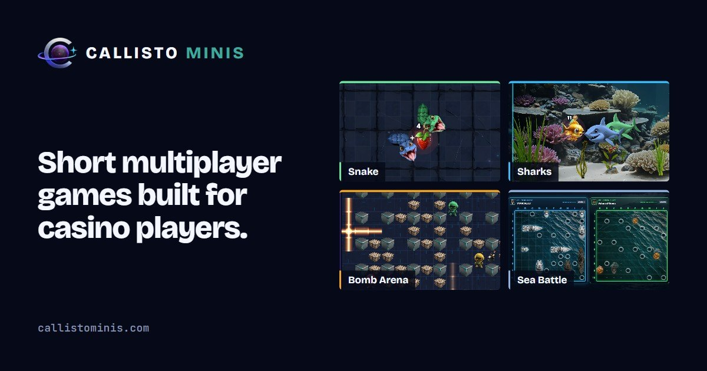
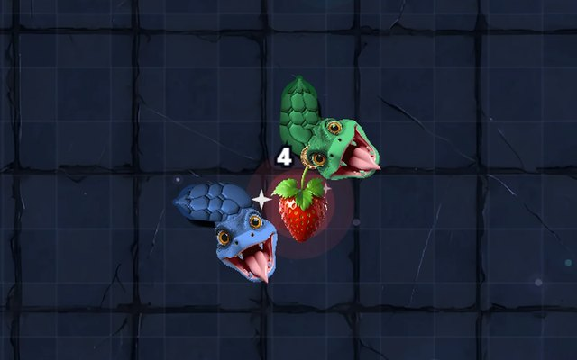
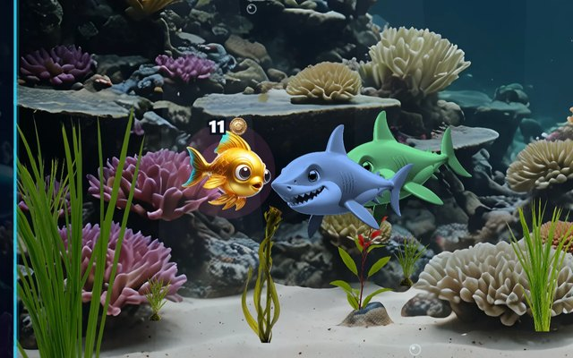
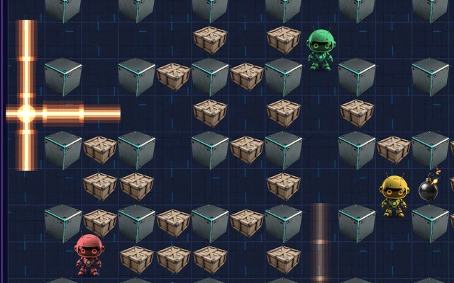
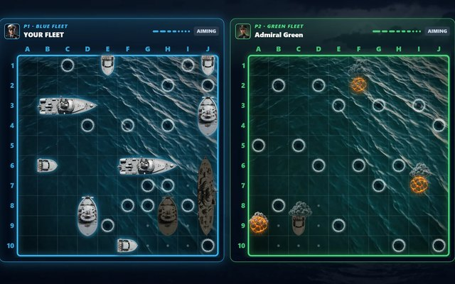

  

<h3 align="center">Short multiplayer games built for casino players. Quick matches, simple rules, players against each other.</h3>

  <a href="https://callistominis.com"><b>callistominis.com</b></a> ·
  <a href="https://callistominis.com/games/snake">Games</a> ·
  <a href="https://callistotech.io">Callisto Tech</a>

---

---

### What we build

- **Player against player** — two to four players in a match, a round in minutes.
- **Server-side rounds** — stakes and payouts are decided and recorded on our servers; the client only shows them.
- **One integration** — a signed operator API and a seamless wallet, the same for every game.
- **Demo mode** — every game can be opened in demo straight from [callistominis.com](https://callistominis.com).
